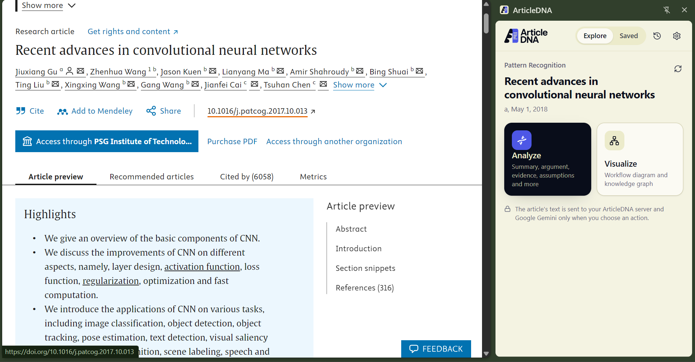
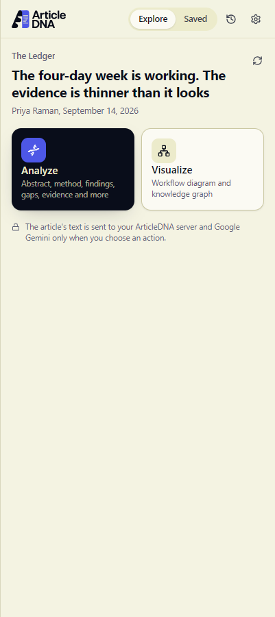
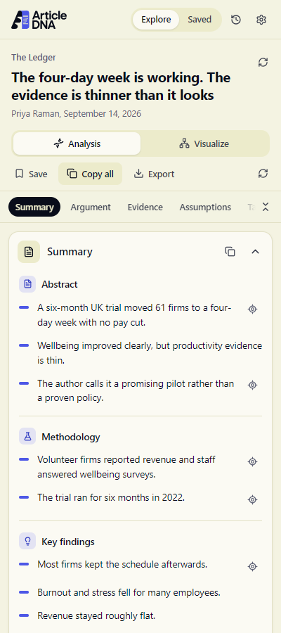
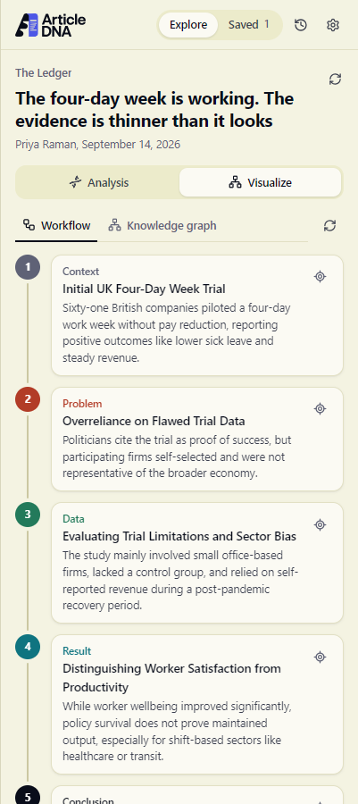
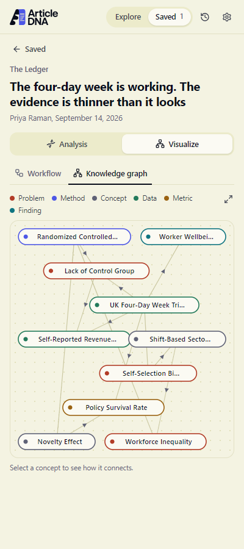
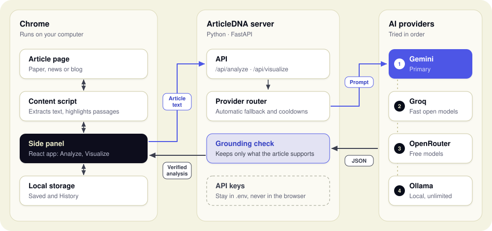

<p align="center">
  
</p>

<h3 align="center">Understand the DNA behind every article.</h3>

<p align="center">
  A Chrome extension that breaks research papers and articles down into what they claim, the
  evidence behind it, what they assume, and what's still open, and draws them as diagrams.
</p>

<p align="center">
  
  
  
  
  
</p>

<p align="center">
  <a href="#-demo"><b>Watch the demo</b></a> ·
  <a href="#-features"><b>Features</b></a> ·
  <a href="#-getting-started"><b>Getting started</b></a> ·
  <a href="#-architecture"><b>Architecture</b></a>
</p>

<p align="center">
  
</p>

---

## 🎬 Demo

<p align="center">
  <a href="https://youtu.be/mK-kIiYlz10">
    
  </a>
  <br>
  <a href="https://youtu.be/mK-kIiYlz10"><b>▶ Watch the demo on YouTube</b></a>
</p>

## ✨ Features

- 🧬 **Smart summary:** research structure for papers (Abstract → Future work), TL;DR to Further reading for articles
- 🎯 **Find in page:** jump to and highlight the exact passage behind every point
- 🔬 **Critical reading:** main argument, evidence strength, assumptions, limitations
- 🕸️ **Visualize:** workflow diagram and interactive knowledge graph
- 🛡️ **Grounded:** quotes, numbers and sources must appear in the article
- 📚 **Saved & History:** stored only in your browser
- ⚡ **Never stuck:** falls back from Gemini to Groq, OpenRouter or Ollama automatically
## 📸 Screenshots

| Explore | Summary | Workflow | Knowledge graph |
| :---: | :---: | :---: | :---: |
|  |  |  |  |

## 🛠️ Tech stack

| Layer | Tools |
| --- | --- |
| Extension | Chrome Manifest V3 side panel, React 19, TypeScript, Tailwind CSS 4, Vite |
| Page reading | Mozilla Readability, CSS Custom Highlight API |
| Diagrams | d3-force, SVG |
| Backend | Python, FastAPI, Pydantic |
| AI | Google Gemini, with Groq, OpenRouter and Ollama fallbacks |
| Storage | Chrome Storage API (local only) |

## 🏗️ Architecture

<p align="center">
  
</p>

The page is read in your browser. Text reaches the server only when you click **Analyze** or
**Visualize**, and API keys never leave it.
## 🚀 Getting started

**1. Backend** (Python 3.11+)

```bash
cd backend
python -m venv .venv
.venv\Scripts\activate          # macOS/Linux: source .venv/bin/activate
pip install -r requirements.txt
copy .env.example .env          # macOS/Linux: cp .env.example .env
```

Add at least one key to `backend/.env`:

| Key | Get it from |
| --- | --- |
| `GEMINI_API_KEY` | <https://aistudio.google.com/apikey> |
| `GROQ_API_KEY` (optional fallback) | <https://console.groq.com/keys> |
| `OPENROUTER_API_KEY` (optional fallback) | <https://openrouter.ai/keys> |

Start the server and keep the window open. On Windows, just double-click **`start-backend.bat`**. Or:

```bash
uvicorn main:app --port 8000
```

**2. Extension** (Node 20+)

```bash
cd extension
npm install
npm run build
```

Open `chrome://extensions`, turn on **Developer mode**, click **Load unpacked** and pick
`extension/dist`.

**3. Use it.** Open a paper or article, click the ArticleDNA icon, and choose **Analyze** or
**Visualize**.

## 🧪 Tests

```bash
cd backend   && .venv\Scripts\python -m pytest
cd extension && npm test
```

---

<p align="center">Made with ❤️ by <b>Bharani Sankar</b></p>
